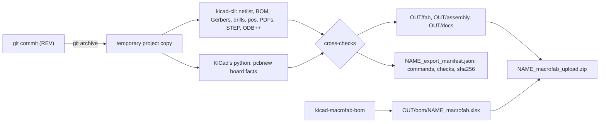

<p align="center">
  
</p>

# kicad-fab-package

**Turn one git commit of a KiCad 10 project into a checked, MacroFab-ready fabrication and assembly package.**

[](LICENSE)
[](pyproject.toml)
[](https://github.com/aqsnyder/kicad-fab-package/actions/workflows/tests.yml)

`kicad-fab-export` writes the Gerbers, the drill files (filled-and-capped vias split into their own file), the
MacroFab XYRS placement file, assembly and schematic PDFs, a STEP model, ODB++, the flat upload zip MacroFab expects
and a manifest with the sha256 of every file. `kicad-macrofab-bom` writes MacroFab's per-designator BOM xlsx and a
checks report. Both cross-check what they write (dozens of checks: schematic against board, drills against copper,
XYRS against KiCad's own position file, solder paste on parts that are not placed, ...) and exit non-zero when one
fails.

## Why

Ordering an assembled board means handing a contract manufacturer a dozen files that must agree with each other and
with the design: the same designators in the BOM and the placement file, the drills in the Gerber frame, no paste
on parts that will not be placed, the right drill file marked as filled. Exporting them by hand from the KiCad GUI
works until the day one setting is different, or the files come from a working tree that was not what got
committed. This tool:

- builds everything from **`git archive` of the commit you name**, never from the working tree, so a package always
  matches a commit and can be rebuilt later;
- runs **fixed, recorded `kicad-cli` commands** (they are listed in the manifest), so two releases are built the
  same way;
- **checks the outputs against each other and against the board** instead of trusting them, and tells you what is
  wrong in words a reviewer can act on;
- writes MacroFab's **upload zip and BOM xlsx in the exact shape MacroFab reads**, so the upload is one file and one
  spreadsheet.

## Features

- Gerbers from the board's own plot settings, checked for X2 attributes and cross-checked against a second plot
  with explicit flags; a Gerber job file cut to the fab layers; a layer map csv.
- Excellon drills with plated, non-plated and **filled-and-capped (IPC-4761 Type VII) vias in separate files**, the
  filled vias selected by the board's `(filling yes) (capping yes)` tokens, never by drill size.
- The **MacroFab XYRS** placement file (mils, bottom-left origin, pad-box centres, MacroFab's bottom-side rotation
  rule), plus KiCad's position file for reference, and pad-1 and body-offset data for placement review.
- Top and bottom (mirrored) **assembly drawing**, schematic PDF, STEP with the XYRS origin, ODB++, and an optional
  [InteractiveHtmlBom](https://github.com/openscopeproject/InteractiveHtmlBom) page.
- **MacroFab BOM xlsx** (one designator per row, shared strings, byte-reproducible), grouped and per-reference BOM
  csvs, a per-designator diff against a baseline BOM, and a report of string-hygiene problems (odd MPN characters,
  manufacturer-name variants, value + package collisions, mixed-Populate groups).
- **Solder paste on unplaced parts** caught twice: in the board and in the plotted paste Gerbers.
- With `--pcbway`, **PCBWay's assembly files** too: the BOM in PCBWay's template layout (one line per part number,
  `SMD` / `thru-hole` / `DNS`), a centroid csv per side and a Gerber zip, made from the XYRS rows and checked against
  them; the MacroFab files stay the same.
- A part library that is a **git submodule or a folder of the repository** (such as `hw/lib` beside the boards,
  reached as `${KIPRJMOD}/../lib`), taken from the commit for the project copy and the STEP models.
- `kicad-bom-check` (regenerate and compare a committed BOM csv), `kicad-bomdiff` (per-reference BOM diff) and
  `kicad-project-copy` (a checked KiCad project copy of any commit).
- A manifest with commands, counts, every check, and the sha256 of every file; reproducible XYRS, BOM xlsx and zip
  member dates.
- Settings by flag, environment variable or a small `kicad-fab.toml` / `kicad-fab.json`; KiCad found automatically on
  Windows, macOS and Linux.

## How it works



Every design file comes from the commit: apart from the optional config file, nothing is read from the working tree,
and nothing in the repository is written.

## Install

```bash
pip install git+https://github.com/aqsnyder/kicad-fab-package
# with the optional extras (PDF merge and designator check, TOML config on Python < 3.11); [all] is the same set
pip install "kicad-fab-package[pdf,toml] @ git+https://github.com/aqsnyder/kicad-fab-package"
```

From a checkout:

```bash
git clone https://github.com/aqsnyder/kicad-fab-package
cd kicad-fab-package
pip install .            # or: pip install ".[pdf,toml]"  (or ".[all]", the same)
```

| Extra | Installs | For |
|---|---|---|
| `pdf` | `pypdf`, `PyMuPDF` | the two-page assembly PDF, and the check that every designator is printed on it |
| `toml` | `tomli` (Python < 3.11 only) | a `kicad-fab.toml` config file on Python 3.9 and 3.10 |
| `all` | everything in `pdf` and `toml` | |
| `test` | `pytest` | running the test suite ([CONTRIBUTING.md](CONTRIBUTING.md)) |

The five commands are installed as console scripts. Each also runs as a module (`python -m
kicad_fab_package.export_fab ...`), and `python -m kicad_fab_package` lists them.

## Requirements

| What | Needed for | Notes |
|---|---|---|
| **KiCad 10** (`kicad-cli` and KiCad's bundled Python with `pcbnew`) | `kicad-fab-export` (both), `kicad-macrofab-bom` and `kicad-bom-check` (`kicad-cli`) | found automatically in the standard install folders; a `kicad-cli` older than 10 gets a warning |
| **git** on `PATH` | every command except `kicad-bomdiff` | the project must be committed |
| **Python 3.9 or newer** | running the tools | any Python; KiCad's own Python is started as a subprocess for one board query (and the iBOM) |
| `openpyxl` | BOM xlsx | installed with the package |
| `pypdf` (optional, `[pdf]`) | one two-page assembly PDF | without it the two pages stay two files (a warning); the designator check below still runs on them |
| `PyMuPDF` (optional, `[pdf]`) | checking every designator is printed on the assembly drawing | without it that check is skipped with a warning (`assembly PDF: designators not checked (no PyMuPDF)`). **PyMuPDF is licensed AGPL-3.0**; it is an optional dependency you install yourself and is never bundled with this MIT-licensed package |
| `tomli` (optional, `[toml]`) | `kicad-fab.toml` on Python < 3.11 | JSON config files need nothing |
| [InteractiveHtmlBom](https://github.com/openscopeproject/InteractiveHtmlBom) (optional) | the iBOM page | an unpacked package folder passed with `--ibom-pkg`; without it the iBOM is skipped with a warning |

## Quick start

From a git repository holding one KiCad 10 project whose board has a `REVISION` text variable:

```bash
cd my-board-repo
kicad-macrofab-bom HEAD --out ../fab/v1.0/bom      # 1. the BOM xlsx first, so the zip can include it
kicad-fab-export   HEAD --out ../fab/v1.0          # 2. the package and the upload zip
```

Real output from KiCad's bundled `pic_programmer` demo (with MPN fields added; see
[Getting started](docs/getting-started.md)), trimmed:

```text
rows 57: Populate 1 = 55 (F 55 / B 0), Populate 0 = 2: JP1, R21
...
CHECKS PASSED

== pic_programmer_v1.0 from 8d621b050 (pic_programmer 1.0) -> ~/boards/fab/v1.0
steps:
  ok   gerbers                9 Gerbers from --board-plot-params; gbrjob cut to them
  ok   drill                  PTH 244 + FILLED 4 (from 248), NPTH 7; top_layer: 248/248 plated hits on a flash; ...
  ok   placement (XYRS, pos)  XYRS 57 rows (55 Populate 1: 55 top / 0 bottom; 2 Populate 0); ...
  ok   upload zip             14 members
...
RESULT: ok (2 warnings)
```

Upload `../fab/v1.0/pic_programmer_v1.0_macrofab_upload.zip` to MacroFab; the [MacroFab
walkthrough](docs/macrofab.md) covers the rest of the order.

Exit codes for every command: `0` ok (warnings are printed), `1` a check or step failed (outputs are still written
so you can see what is wrong), `2` setup error.

## Usage examples

```bash
# pin the counts of a reviewed release: the export fails if any of them changes
kicad-fab-export v1.1 --out ../fab/v1.1 --expect fitted=56,rows=57,pop0=1,pth=244,filled=4,npth=7,pages=2

# re-pack the upload zip and refresh the manifest after editing bom/ or adding a README to the package
kicad-fab-export --zip-only --out ../fab/v1.1

# BOM with a per-designator diff against the previous release's BOM xlsx (committed, or a local file)
kicad-macrofab-bom v1.1 --out ../fab/v1.1/bom --baseline HEAD:hw/release/pic_programmer_v1.0_macrofab.xlsx --baseline-label v1.0
kicad-macrofab-bom v1.1 --out ../fab/v1.1/bom --baseline ../fab/v1.0/bom/pic_programmer_v1.0_macrofab.xlsx --baseline-label v1.0

# is the committed grouped BOM csv still what the schematic gives?
kicad-bom-check HEAD --csv hw/release/pic_programmer_bom.csv

# what changed between two releases, reference by reference
kicad-bom-check v1.0 --perref --out ../bomdiff/v1.0
kicad-bom-check v1.1 --perref --out ../bomdiff/v1.1
kicad-bomdiff ../bomdiff/v1.0/v1.0.perref.csv ../bomdiff/v1.1/v1.1.perref.csv
```

## Documentation

| Page | Contents |
|---|---|
| [docs/index.md](docs/index.md) | overview and map of the docs |
| [Getting started](docs/getting-started.md) | install, first run on a KiCad project in git, what lands where |
| [kicad-fab-export](docs/export-fab.md) | every output file, every check and what a FAIL means, the manifest, the upload zip |
| [MacroFab walkthrough](docs/macrofab.md) | uploading the package, layer mapping, filled vias, BOM upload, alternates, consigned parts, the DFM email |
| [XYRS placement format](docs/xyrs.md) | units, origin, position, rotation, sides, types, with a worked example |
| [PCBWay](docs/pcbway.md) | the PCBWay BOM, centroid files and Gerber zip of `--pcbway` |
| [BOM tools](docs/bom.md) | the BOM xlsx, the checks report, `kicad-bom-check` and `kicad-bomdiff` |
| [CLI reference](docs/cli.md) | every command, flag, default and environment variable |
| [Configuration](docs/configuration.md) | every config key with type, default and example |
| [Troubleshooting / FAQ](docs/troubleshooting.md) | real error messages and what to do about them |

## Configuration summary

Every setting has a generic default; set it with a flag, an environment variable (KiCad paths only) or a config file.
Precedence: **flag > environment > config file > default**. The config file is `--config FILE`, else
`$KICAD_FAB_CONFIG`, else `kicad-fab.toml` or `kicad-fab.json` at the top of the git repository:

```toml
project_dir = "hw"                                           # where the .kicad_pro lives
baseline_paths = ["release/pic_programmer_v1.0_macrofab.xlsx"]  # BOM to diff the next release against
baseline_label = "v1.0"
```

| Environment variable | Meaning |
|---|---|
| `KICAD_CLI` | the `kicad-cli` to use (else the newest standard install, else `PATH`) |
| `KICAD_PYTHON`, `KICAD10_PYTHON` | KiCad's Python with `pcbnew` (else the one next to `kicad-cli`) |
| `KICAD10_3DMODEL_DIR` | KiCad's 3-D model library |
| `KICAD_FAB_CONFIG` | the config file |

All 22 keys are in [docs/configuration.md](docs/configuration.md).

## Limitations and known issues

- **KiCad 10 only** (its board format and `kicad-cli` options). The project must be committed, and its folder must
  hold exactly one `.kicad_pro`.
- **MacroFab first**: the XYRS format, the upload member names, the BOM layout and the DFM notes follow MacroFab's
  rules. `--pcbway` adds PCBWay's BOM, centroid files and Gerber zip; other assembly houses need other formats.
- The bottom-side rotation rule (KiCad orientation + 180) matches MacroFab's own generator; check bottom-side pin 1
  in MacroFab's placement view (the manifest lists every part's pad-1 offset).
- Through vias only (blind or buried vias fail a check), no slots or routed holes in the drill files (draw slots on
  Edge.Cuts), and the board must plot with the absolute origin (`useauxorigin no`).
- Fiducials and mounting holes are recognised by designator (`FID*`, `H*`) or by KiCad's `Fiducial` / `MountingHole`
  footprint libraries unless you configure `non_part_refs` / `non_part_libs`.
- Non-ASCII characters in Value, Footprint or MPN fail a check and are written as `?` in the XYRS (the rest of the
  package is still produced so you can see everything that is wrong at once).
- The grouped BOM csv recipe (`MPN`, `Voltage`, `Type`, `Tolerance`, `TempCo` fields) is fixed.
- Do not run two exports at the same time on one machine: concurrent `kicad-cli` ODB++ exports have been seen to
  write an incomplete archive.
- A failed export keeps its temporary work folder (the summary names it) so you can inspect it; delete it yourself.
- On Windows, very long paths may need `git config core.longpaths true`.

More in [Troubleshooting](docs/troubleshooting.md).

## Contributing

Issues and pull requests are welcome: see [CONTRIBUTING.md](CONTRIBUTING.md). The unit tests need no KiCad; the
integration test runs the whole flow on KiCad's `pic_programmer` demo when KiCad 10 is installed and skips itself
otherwise.

## License and credits

MIT; see [LICENSE](LICENSE).

- `lz_decompress_b64` in `kicad_fab_package/export_fab.py` (reads the data of the InteractiveHtmlBom page) and the
  compressor in `tests/test_export_fab.py` are Python ports of [lz-string](https://github.com/pieroxy/lz-string),
  MIT License, Copyright (c) 2013 pieroxy.
- The tools drive [KiCad](https://www.kicad.org) (`kicad-cli` and its `pcbnew` module) as external programs; KiCad is
  not included.
- Optional dependencies are installed separately and not bundled: [openpyxl](https://openpyxl.readthedocs.io) (MIT),
  [pypdf](https://github.com/py-pdf/pypdf) (BSD-3-Clause), [PyMuPDF](https://github.com/pymupdf/PyMuPDF)
  (**AGPL-3.0**), [tomli](https://github.com/hukkin/tomli) (MIT) and
  [InteractiveHtmlBom](https://github.com/openscopeproject/InteractiveHtmlBom) (MIT).

MacroFab is a trademark of its owner; this project is independent and not affiliated with or endorsed by MacroFab.
